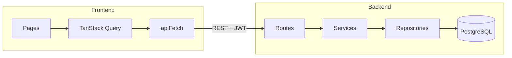

# CampusFlow

Real-time collaboration for university study groups.

- **Phase 1** — register, sign in, create and join groups, manage members.
- **Phase 2** — a Kanban task board per group: create, edit, assign, prioritize, schedule, and move tasks between To do / In progress / Done.
- **Phase 3** — group chat: live messages over SSE, paged history, connection status, and moderation.
- **Phase 4** — study sessions with RSVPs and a month calendar, shared resources, and an upcoming-events section on the dashboard.
- **Phase 5** — an in-app inbox: assignments, new sessions, shared resources, and RSVPs, delivered live over SSE.

## Architecture

```
Browser (React + Vite)
        |
        |  Authorization: Bearer <JWT>          (writes: REST)
        |  text/event-stream                    (reads: live events)
        v
FastAPI  (/api/..., /health)
        |
        +--> PostgreSQL  (users, study_groups, group_memberships, tasks, messages, sessions, resources, notifications)
        +--> Redis       (pub/sub fan-out for chat across workers)
```



### Why this shape

**Layered FastAPI (routes → services → repositories).** Routes validate and call services. Services own authorization and transactions. Repositories own SQL. Alternative: fat route handlers. Tradeoff: a few extra files in exchange for tests that can target rules like "owners cannot leave" without HTTP.

**JWT access tokens in the `Authorization` header.** Matches a split SPA/API deployment and is easy to test. Alternative: httpOnly cookies (better XSS protection, CSRF to manage) or access+refresh rotation (better idle sessions). Phase 1 keeps a single 8-hour access token.

**Argon2id password hashing.** Current OWASP recommendation (memory-hard). Alternative: bcrypt, which is more common in tutorials but weaker against GPU cracking and caps passwords at 72 bytes.

**UUID primary keys.** Prevents guessing sequential IDs. Alternative: bigserial (smaller indexes, easier debugging).

**Open join in Phase 1.** Any authenticated student can join any group. Owners/admins can remove members. Alternative: invite/approval workflows — better control, slower MVP.

**SSE, not WebSockets, for chat.** Chat looks bidirectional, but only delivery is push: sending a message is an ordinary authenticated write that wants validation, persistence, authorization, and throttling, so it stays a `POST`. That leaves one server→client stream, which is exactly what SSE is for — and reconnection plus gap recovery (`Last-Event-ID`) come with the protocol. Alternative: WebSockets, which would earn their place for typing indicators or presence heartbeats. Tradeoff: SSE is one connection per group tab and cannot carry client→server frames.

**The stream is consumed with `fetch`, not `EventSource`.** `EventSource` cannot set request headers, so using it would mean putting the JWT in the query string, where it lands in server logs, proxy logs, and browser history. Reading the response body as a stream keeps the bearer token in an `Authorization` header and lets the client send `Last-Event-ID` itself. Tradeoff: reconnection and backoff become our code (`useMessageStream`) rather than the browser's.

**Two real broker implementations, not one plus a stub.** `RedisBroker` (pub/sub, crosses processes) is used whenever `REDIS_URL` answers; `InMemoryBroker` (asyncio fan-out) is used when it does not. Both are functional — the in-memory one simply cannot cross worker processes, and the choice is logged at startup so a downgrade is never silent.

**The stream route holds no database connection.** `get_db` releases its connection when the *response* finishes, and an SSE response finishes when the tab closes. Depending on it would pin one pooled connection per open chat, and a handful of tabs would drain the pool for the entire API. The route authenticates from the token alone, borrows a session just long enough to check membership, and then streams from the broker.

**Messages are published only after the transaction commits.** Publishing inside the transaction would let subscribers render a message that a rollback then erases, with no reload able to bring it back.

**Keyset pagination for history, not `OFFSET`.** Chat inserts constantly at the newest end, so with `OFFSET` a message posted while someone scrolls back shifts every later page and produces a visible duplicate or gap. Comparing on `(created_at, id)` is stable under inserts and matches the composite index exactly.

**Notifications are persisted rows, not ephemeral toasts.** A student who was offline still has an inbox after they come back. Chat messages are *not* copied into that inbox: the conversation already has a history and a live stream, and one row per message would bury the events that actually matter.

**The inbox stream is per user, not per group.** A notification is personal, so it fans out on `campusflow:user:{id}:events`. Same transport as chat (`fetch` + `Last-Event-ID`), same commit-then-publish rule, same "hold no database connection while streaming" constraint.

**Raw ASGI middleware instead of Starlette `BaseHTTPMiddleware`.** The latter spawns a child task that breaks asyncpg (`Future attached to a different loop`).

**Kanban movement via a labelled status control, not pointer drag-and-drop.** Alternative: dnd-kit. Tradeoff: dragging feels better with a mouse but needs a parallel keyboard path and live-region announcements to be accessible; a `select` works with keyboard, touch, and screen readers immediately. The board still updates optimistically so a move feels instant.

**Shared `services/access.py`.** Every group-scoped feature asks the same question — is this caller a member, and what is their role? Centralizing it means a new feature cannot silently skip the check.

## Repository structure

```
.
├── backend/
│   ├── app/
│   │   ├── api/            # thin HTTP routes
│   │   ├── core/           # config, security, errors, logging, middleware
│   │   ├── db/             # engine + session
│   │   ├── models/         # SQLAlchemy
│   │   ├── repositories/
│   │   ├── schemas/        # Pydantic
│   │   └── services/       # business rules (access.py = shared authz)
│   ├── alembic/
│   ├── scripts/            # entrypoint, development seed
│   └── tests/
├── frontend/
│   └── src/
│       ├── api/
│       ├── components/
│       ├── features/
│       ├── layouts/
│       ├── pages/
│       ├── routes/
│       ├── types/
│       └── utils/
├── docker/postgres/
├── docker-compose.yml
└── .env.example
```

## Domain

Nine tables exist today.

| Entity | Role |
| --- | --- |
| `users` | Account + profile. Email is unique and stored lowercase. |
| `study_groups` | Group metadata. `owner_id` is the creating user. |
| `group_memberships` | `(user_id, group_id)` unique. Roles: `owner`, `admin`, `member`. |
| `tasks` | Belongs to a group. Status `TODO`/`IN_PROGRESS`/`DONE`, priority `LOW`/`MEDIUM`/`HIGH`, optional assignee and due date. |
| `messages` | Belongs to a group. Author, body (≤ 2000 chars), timestamp. |
| `study_sessions` | Belongs to a group. Title, optional description/location, `start_time`/`end_time` as `timestamptz`. |
| `session_rsvps` | `(session_id, user_id)` unique. Status `going`/`maybe`/`declined`. |
| `resources` | Belongs to a group. Title, URL, optional description, sharer. |
| `notifications` | Belongs to a user. Type, title, body, link, optional actor/group, `read_at`. |

Creating a group writes the group and an `owner` membership in one transaction.

Task integrity rules worth knowing:

- A task can only be assigned to a **current member** of its group (`422 assignee_not_member`).
- When a member leaves or is removed, their assignments in that group are **cleared, not deleted** — in the same transaction as the membership delete.
- Deleting a group cascades to its tasks.

Message rules worth knowing:

- History survives its author leaving the group; the message shows as "Former member" rather than disappearing. Deleting the **user** or the **group** cascades.
- Posting is throttled to 20 messages per 10 seconds per user (`429 rate_limited`), which is the most spammable endpoint in the product.

Session and resource rules worth knowing:

- A session must end after it starts and cannot run longer than 24 hours. Both are enforced in the schema layer **and** by a `CHECK` constraint, because a bad row is worse than a bad request.
- Whoever schedules a session is RSVP'd `going` automatically; they would not have created it otherwise.
- A session counts as upcoming while it is still running — the filter is on `end_time`, not `start_time`, so a session in progress does not vanish from the list halfway through.
- RSVP is an idempotent `PUT`. Answering twice is the same as answering once, and the unique constraint means a double-click cannot create two rows.
- Resource URLs must be `http` or `https`. A `javascript:` or `data:` link rendered as an anchor is stored XSS, so the scheme is allowlisted on write and the anchor carries `rel="noopener noreferrer"`.

Indexes: `(group_id, status)` for board reads, `assigned_to` for "my tasks", `due_date` for deadline ordering, `(group_id, created_at, id)` matching the chat pagination `ORDER BY` exactly, `(group_id, start_time)` for calendar range scans, and `(group_id, created_at)` for the resource list.

RSVP tallies come from one aggregate subquery joined onto the session list (`count(*) FILTER (WHERE status = …)`), so a month of sessions is still a single round trip rather than one count per session.

Notification rules worth knowing:

- The actor is never notified of their own action.
- Re-assigning a task notifies only the new assignee, and only if they changed.
- An identical RSVP `PUT` does not write a second row.
- Guessing another student's notification id returns `404`, not `403`, so existence is not leaked.

## Authentication flow

1. `POST /api/auth/register` hashes the password with Argon2id and returns `{ access_token, user }`.
2. `POST /api/auth/login` verifies the hash (same error if the email is unknown).
3. The SPA stores the token in `localStorage` and sends `Authorization: Bearer …`.
4. `GET /api/users/me` and every group route require a valid token.
5. Resource checks happen in services: membership, owner/admin, owner-cannot-leave, etc.

## API

| Method | Path | Notes |
| --- | --- | --- |
| GET | `/health` | Liveness |
| GET | `/health/ready` | Postgres ping |
| POST | `/api/auth/register` | 201 + token |
| POST | `/api/auth/login` | token |
| GET | `/api/users/me` | current user |
| PATCH | `/api/users/me` | profile fields |
| POST | `/api/groups` | create; caller becomes owner |
| GET | `/api/groups` | discover. `?mine=true` for memberships. `?search=` |
| GET | `/api/groups/{id}` | any authenticated user |
| PATCH | `/api/groups/{id}` | owner or admin |
| DELETE | `/api/groups/{id}` | owner |
| POST | `/api/groups/{id}/join` | 409 if already a member |
| DELETE | `/api/groups/{id}/leave` | 409 if owner |
| GET | `/api/groups/{id}/members` | members only |
| PATCH | `/api/groups/{id}/members/{user_id}` | owner; `admin` or `member` |
| DELETE | `/api/groups/{id}/members/{user_id}` | owner/admin; cannot remove owner |
| POST | `/api/groups/{id}/tasks` | any member creates |
| GET | `/api/groups/{id}/tasks` | board read. `?status=`, `?assigned_to=` |
| GET | `/api/tasks/mine` | assigned to caller, across groups. `?include_done=` |
| GET | `/api/tasks/{task_id}` | member of the task's group |
| PATCH | `/api/tasks/{task_id}` | any member; partial update |
| DELETE | `/api/tasks/{task_id}` | task creator, or group owner/admin |
| POST | `/api/groups/{id}/messages` | any member; throttled |
| GET | `/api/groups/{id}/messages` | history, oldest-first. `?before=<message_id>&limit=` |
| GET | `/api/groups/{id}/stream` | SSE. Honours `Last-Event-ID` |
| DELETE | `/api/messages/{message_id}` | author, or group owner/admin |
| POST | `/api/groups/{id}/sessions` | any member schedules |
| GET | `/api/groups/{id}/sessions` | `?upcoming=`, `?starts_after=`, `?starts_before=` |
| GET | `/api/sessions/mine` | upcoming sessions across the caller's groups |
| GET | `/api/sessions/{session_id}` | member of the session's group |
| PATCH | `/api/sessions/{session_id}` | organiser, or group owner/admin |
| DELETE | `/api/sessions/{session_id}` | organiser, or group owner/admin |
| PUT | `/api/sessions/{session_id}/rsvp` | idempotent; `going`/`maybe`/`declined` |
| DELETE | `/api/sessions/{session_id}/rsvp` | withdraw an answer |
| GET | `/api/sessions/{session_id}/rsvps` | who answered what |
| POST | `/api/groups/{id}/resources` | any member shares; `http(s)` only |
| GET | `/api/groups/{id}/resources` | `?search=` over title + description |
| PATCH | `/api/resources/{resource_id}` | sharer, or group owner/admin |
| DELETE | `/api/resources/{resource_id}` | sharer, or group owner/admin |
| GET | `/api/notifications` | caller's inbox. `?unread_only=` |
| GET | `/api/notifications/unread-count` | `{ unread }` |
| POST | `/api/notifications/read-all` | marks every unread row |
| PATCH | `/api/notifications/{id}/read` | 404 if it is not yours |
| GET | `/api/notifications/stream` | SSE. Honours `Last-Event-ID` |

Task permissions in one line: **any member can create, edit, and move any task on their group's board; only the creator or an owner/admin can delete one.** A shared board is the point of a study group, and deletion is the only irreversible action.

Every single-task route authorizes against the group derived from the task, so a task id from another group returns `403 not_a_member` rather than succeeding. The same holds for messages, sessions, RSVPs, and resources: the id is never trusted to imply access.

### The chat stream

`GET /api/groups/{id}/stream` returns `text/event-stream` and emits:

| Event | Carries an `id` | Meaning |
| --- | --- | --- |
| `ready` | no | Subscribed. Reports which broker is active. |
| `message.created` | yes (the message id) | New message, same JSON shape as the REST history item. |
| `message.deleted` | no | `{ id, group_id }`. A deleted row cannot anchor a replay, so no cursor. |
| `ping` | no | Heartbeat every 20s so idle proxies do not close the connection. |

On reconnect the client sends `Last-Event-ID`; the server replays messages posted since that one (capped at 100) before going live. The subscription is opened **before** the catch-up query, so the window between them produces a duplicate rather than a lost message — and the duplicate is filtered out.

`MessageResponse` deliberately has no `can_delete` flag: permission depends on the viewer, and a broadcast has many viewers. The client derives it from `user_id` plus its own role, and the server re-checks on `DELETE`.

Pagination cursor: pass the `next_cursor` from a page as `before` to fetch the page before it. A cursor belonging to a different group is rejected with `400 invalid_cursor`.

### The inbox stream

`GET /api/notifications/stream` is the same protocol on a per-user channel. `notification.created` carries the notification id as the frame id so a reconnect can replay the gap. Chat messages never appear here.

Errors use a single envelope:

```json
{
  "error": {
    "code": "not_a_member",
    "message": "You are not a member of this group",
    "details": [],
    "request_id": "…"
  }
}
```

## Frontend pages

| Route | Page |
| --- | --- |
| `/` | Landing |
| `/login` | Login |
| `/register` | Register |
| `/app` | Dashboard (my groups, tasks due soon, upcoming sessions) |
| `/app/groups` | My groups + create |
| `/app/discover` | Discover / join |
| `/app/groups/:id` | Group overview |
| `/app/groups/:id/members` | Members |
| `/app/groups/:id/tasks` | Kanban board |
| `/app/groups/:id/messages` | Group chat |
| `/app/groups/:id/sessions` | Study sessions: agenda or month calendar |
| `/app/groups/:id/resources` | Shared links |
| `/app/profile` | Profile |
| `*` | 404 |

The signed-in header has a **Notifications** menu with an unread badge. Opening an item marks it read and goes to the relevant group page.

Reusable UI: `Button`, `TextField`, `SelectField`, `TextAreaField`, `Modal`, `ConfirmDialog`, `EmptyState`, `Alert`, `Spinner`.

`TaskBoard`, `MessageList`, and `MessageComposer` are presentational — data fetching and mutations live in `TasksPage` / `MessagesPage` — so they can be tested with plain props and no query client.

Chat specifics:

- The transcript lives in component state rather than the query cache, because it is an append-only log fed by two sources at once (paged history and the live stream) that can both deliver the same message. One sorted, de-duplicated array makes the ordering explicit.
- A sent message is inserted from the `POST` response rather than waiting for the broadcast to loop back, so the sender never watches their own message lag. The stream echo is de-duplicated by id.
- Connection state is shown, never inferred: a chat that has silently stopped updating looks exactly like a chat where nobody is talking.
- Scroll is pinned to the bottom only when the reader is already near it, and held in place when older messages are prepended, so the page never jumps mid-read.
- The transcript is a `role="log"` with `aria-live="polite"`; Enter sends and Shift+Enter adds a newline.

Session specifics:

- Times are sent to the server as UTC instants and rendered in the reader's own time zone. A group spread across time zones sees the same moment, each in their own local clock.
- The calendar is a real `<table>` with a `<caption>` and `scope="col"` headers, and each session on it is a button. A grid of `<div>`s would look the same and be unusable with a screen reader.
- Agenda and calendar are separate queries (`upcoming` vs. a month range) rather than one list filtered client-side, so switching months does not refetch the entire history.
- The RSVP control is a `radiogroup`: three answers, one of which may be chosen. Picking the current answer again withdraws it, which is the only way to get back to "no answer" without a fourth button that means nothing.
- The session form defaults to the next whole hour and drags the end time along when the start moves past it, so the common case needs no date arithmetic from the user.

## Local setup

Requires Python 3.12, Node 22+, and PostgreSQL 16. Redis is optional: without it, chat still works end to end on a single API worker, and the API logs which broker it selected at startup.

### 1. Environment

```bash
cp .env.example .env
python3 -c "import secrets; print(secrets.token_urlsafe(48))"
# paste the result into JWT_SECRET (min 32 characters; do not leave the change-me placeholder)
```

### 2. Database

```sql
CREATE ROLE campusflow LOGIN PASSWORD 'campusflow';
CREATE DATABASE campusflow OWNER campusflow;
CREATE DATABASE campusflow_test OWNER campusflow;
```

`campusflow_test` is used only by pytest.

### 3. Backend

```bash
cd backend
python3.12 -m venv .venv
source .venv/bin/activate
pip install -e ".[dev]"
alembic upgrade head
uvicorn app.main:app --reload --port 8000
```

Optional demo data (development only):

```bash
python -m scripts.seed
```

Demo login after seed: `ada@university.edu` / `CampusFlow1`.

### 4. Frontend

```bash
cd frontend
npm install
npm run dev
```

Open [http://localhost:5173](http://localhost:5173). The SPA calls `VITE_API_URL` (default `http://localhost:8000`).

## Docker Compose

```bash
docker compose up --build
```

Starts Postgres, Redis, the API (runs migrations on boot), and the Vite dev server.

If port 5432 is already in use on the host, either stop the local Postgres or change the published port in `docker-compose.yml`.

## Testing

```bash
# backend (uses campusflow_test)
cd backend
pytest

# frontend
cd frontend
npm test -- --run
npm run typecheck
```

Coverage today:

- **Backend (142 tests)** — everything in phases 1–4, plus inbox targeting (assignee / other members / organiser, never the actor), idempotent RSVP and re-assignment, unread counts, mark-read isolation (`404` not `403`), exclusion of chat messages, and the per-user stream (live delivery, no cross-user leak, `Last-Event-ID` replay).
- **Frontend (94 tests)** — phases 1–4 coverage, plus the notification menu (empty state, unread badge, mark all as read, Escape to close) and the inbox SSE client's frame parsing, chunk reassembly, header-not-query-string auth, disabled-when-logged-out, and `Last-Event-ID` resume.

Two levels of test cover the stream, deliberately. `httpx`'s ASGI transport buffers a response body before returning it, so it can never observe an endless stream — pointing it at the stream endpoint simply hangs. Framing and replay are therefore driven through the event generator directly, and one test runs a real uvicorn server to prove bytes actually arrive incrementally over a socket. That second test is the one that would catch "works in tests, silently buffers in the browser".

Migrations are reversible; `alembic downgrade 0001_phase1 && alembic upgrade head` is part of manual verification.

Manual check for chat, which no unit test fully replaces: open the same group in two browsers signed in as different members, and confirm a message typed in one appears in the other without a reload, that the status reads "Live", and that killing the API flips it to "Reconnecting…" and back once the API returns.

## Environment variables

See `.env.example`. Secrets stay in `.env`, which is gitignored.

| Variable | Purpose |
| --- | --- |
| `DATABASE_URL` | PostgreSQL URL (`postgresql://` is rewritten to asyncpg / psycopg) |
| `JWT_SECRET` | HMAC key, ≥ 32 characters |
| `JWT_EXPIRE_MINUTES` | Access token lifetime (default 480) |
| `CORS_ORIGINS` | Comma-separated browser origins |
| `REDIS_URL` | Chat pub/sub. If unreachable the API falls back to in-process fan-out (single worker only) and logs it |
| `VITE_API_URL` | Frontend API base URL |

## Screenshots

_Add product screenshots here after a local run._

## Architecture diagram

_Replace this section with an exported diagram if you present the project. The mermaid chart above is the Phase 1 source of truth._
